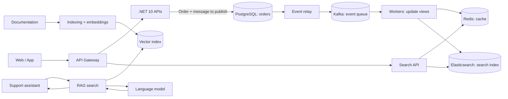

# Developer interview — NovaMarket

**Duration: 50–60 min.** Ask core questions 1–6; choose one or two reserves based on the role. Candidates do not need to know any internal repository.

## The fictional system

NovaMarket is an online store. PostgreSQL is the authoritative store for orders. When an order changes, the same database transaction also records a message to publish (the “outbox”). A relay sends it to Kafka; workers then update the Redis cache and Elasticsearch search index. Separately, a support assistant searches documentation passages to help draft a sourced answer (RAG).

**Fictional incident card** (exercise figures, not real data): an 8x campaign is planned; in a test, p99 rises from 250 ms to 2.4 s, 5xx reaches 4%, PostgreSQL pool wait exceeds 800 ms and Kafka message age reaches 3 min.

## Core questions

| # | Scenario | Main question | Follow-ups |
|---|---|---|---|
| 1 | C# / cancellation | A client cancels a `GET` during a PostgreSQL read. Trace the `CancellationToken` from ASP.NET Core to the repository. How would you distinguish client cancellation, timeout and dependency failure? | Which async signatures need checking? What test proves cancellation reaches the actual DB command? |
| 2 | Load spike | During the 8x campaign, how would you locate the bottleneck before changing code? | Which logs, metrics and traces would you correlate? How would you measure p95/p99, fan-out and pool wait under repeatable load? |
| 3 | PostgreSQL / transaction | The order is committed, but event publication fails. What can the client observe and what state remains? | How would you test failures between business commit, outbox relay and HTTP response? What happens on a client retry? |
| 4 | Kafka / duplicates | A worker updates Elasticsearch and stops before the offset is durable; the message is delivered again. How would you trace the path and verify the outcome? | How do you distinguish invalid message, transient failure and host cancellation? Which test covers a side effect followed by a crash? |
| 5 | Redis / Elasticsearch | PostgreSQL contains the new value, but search returns a stale Redis entry or a lagging Elasticsearch document. How would you diagnose it and classify the response? | Which signals separate stale cache, projection lag and missing business data? What behavior should be tested during recovery? |
| 6 | Tests / C# resilience | Propose a test suite for a dependency timeout or 503, followed by recovery. | What belongs in unit, integration, contract or load tests? How do you prevent a retry from hiding a failure or amplifying load? |

## Reserve questions — production AI

| # | Scenario | Main question | Follow-ups |
|---|---|---|---|
| 7 | RAG | Support needs cited answers from product procedures updated every week. What is RAG for in this case, and what would its minimal usage flow be? | Which pitfall would you check first: stale documents, access rights or irrelevant retrieval? |
| 8 | Agent harness | Support needs to read an order status through a read-only MCP tool. What is an agent harness for here, and how would you use it to govern the call? | Which pitfall would you prioritize: broad permissions, untrusted tool output or retry after a timeout? |

All context needed for the interview is included in this sheet.
