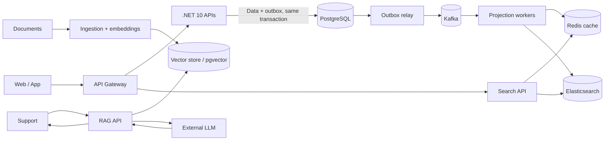

# Lead developer interview — NovaMarket

**Duration: 50–60 min.** Select about six core questions and one reserve if time allows. Candidates do not need to know any internal repository.

## The fictional system

NovaMarket is an online store. PostgreSQL is the source of truth; the outbox is written in the same business transaction. Redis accelerates reads, Elasticsearch serves search. The RAG path is separate from checkout.

**Fictional incident card** (exercise figures, not real data): an 8x campaign is planned; in a test, p99 rises from 250 ms to 2.4 s, 5xx reaches 4%, PostgreSQL pool wait exceeds 800 ms and Kafka message age reaches 3 min.

## Core questions

| # | Scenario | Main question | Follow-ups |
|---|---|---|---|
| 1 | Capacity / SLO | How would you define SLI/SLOs for the API, search and Kafka projections during this campaign? How would you turn the fictional signals into an operational decision? | Which windows and percentiles? What thresholds trigger protection, a deployment pause or product communication? |
| 2 | Active incident | p99 and 5xx rise, the PostgreSQL pool is waiting and Kafka message age increases. Describe the first 15 minutes and recovery. | How do you split diagnosis, mitigation, communication and ownership? What evidence should be preserved for the postmortem and follow-up actions? |
| 3 | Kafka / consistency | A business effect is committed but the consumer fails before the offset; replay creates a duplicate or delays a projection. What guarantees would you offer and how would you assign ownership? | How do you handle ordering, retries, poison messages, replay and lag measurement? What test evidence is required before replay? |
| 4 | Degraded reads | Redis slows down and Elasticsearch lags while PostgreSQL is current. What product behavior do you define for each data type and path? | Where is stale data acceptable, where should the request fail, and how is degradation shown? How do you verify convergence, deletion and recovery? |
| 5 | Test / release / rollback | What load and fault-testing plan would validate the campaign and a release that changes projections? | How do you separate unit, integration, soak, peak-load and fault-injection tests? Which thresholds, canary and stop/rollback criteria make the decision verifiable? |
| 6 | .NET resilience / libraries | Several APIs and workers share a C# client/retry library. How do you prevent a timeout/retry or cancellation change from turning a downstream failure into a request storm? | How do you version and roll it out? Which compatibility tests, telemetry and owners are required? |

## Reserve questions — AI architecture and harness

| # | Scenario | Main question | Follow-ups |
|---|---|---|---|
| 7 | RAG | Support needs sourced answers from procedures that change every week. What is RAG for here, and when would you choose it over ordinary search or fine-tuning? | Which production risk would you prioritize: freshness, access rights, retrieval quality or cost? |
| 8 | Agent harness | An assistant must read an order status and, after human approval, request a refund through a tool. What is an agent harness for in this flow, and which part of execution should it own? | Which recovery pitfall would you handle first if the tool call times out with an unknown outcome? |

All context needed for the interview is included in this sheet.
