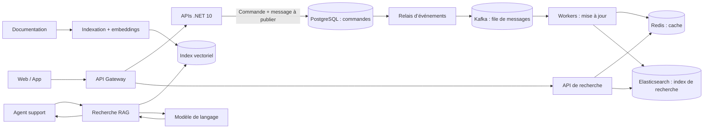

# Entretien développeur — NovaMarket

**Durée : 50–60 min.** Poser les questions centrales 1–6 ; choisir une ou deux questions de réserve selon le poste. Le candidat ne doit connaître aucun dépôt interne.

## Le système fictif

NovaMarket est une boutique en ligne. PostgreSQL fait foi pour les commandes. Quand une commande change, la même transaction enregistre aussi un message à publier (l’« outbox »). Un relais envoie ce message dans Kafka ; des workers mettent ensuite à jour le cache Redis et l’index de recherche Elasticsearch. À part, l’assistant du support cherche des passages dans la documentation pour aider à rédiger une réponse sourcée (RAG).

**Carte d’incident fictive** (chiffres d’exercice, pas des données réelles) : campagne x8 prévue ; en test, le p99 passe de 250 ms à 2,4 s, le taux 5xx atteint 4 %, l’attente du pool PostgreSQL dépasse 800 ms et l’âge du message Kafka atteint 3 min.

## Questions centrales

| # | Scénario | Question principale | Relances |
|---|---|---|---|
| 1 | C# / annulation | Un client annule un `GET` pendant une lecture PostgreSQL. Tracez le `CancellationToken` depuis ASP.NET Core jusqu’au repository. Comment distingueriez-vous annulation client, timeout et panne de dépendance ? | Quelles signatures async faut-il vérifier ? Quel test prouverait que l’annulation traverse réellement la commande DB ? |
| 2 | Pic de charge | Pendant la campagne x8, comment localiseriez-vous le goulot avant de modifier le code ? | Quels logs, métriques et traces relieriez-vous ? Comment mesurer p95/p99, fan-out et attente du pool sous une charge reproductible ? |
| 3 | PostgreSQL / transaction | La commande est commitée, mais la publication de l’événement échoue. Que peut observer le client et quel état reste dans le système ? | Comment testeriez-vous un échec entre commit métier, relais outbox et réponse HTTP ? Que se passe-t-il lors d’un retry du client ? |
| 4 | Kafka / doublons | Un worker met à jour Elasticsearch puis s’arrête avant l’avancement durable de l’offset ; le message est relivré. Comment suivez-vous le parcours et vérifiez-vous le résultat ? | Que distinguez-vous entre message invalide, erreur temporaire et annulation ? Quel test couvre un effet de bord suivi d’un crash ? |
| 5 | Redis / Elasticsearch | PostgreSQL contient la nouvelle valeur, mais la recherche renvoie une ancienne entrée Redis ou un document Elasticsearch en retard. Comment diagnostiqueriez-vous et qualifieriez-vous la réponse ? | Quels indicateurs séparent cache stale, retard de projection et absence métier ? Quel comportement faut-il tester pendant le rétablissement ? |
| 6 | Tests / résilience C# | Proposez une suite de tests pour un timeout ou une réponse 503 d’une dépendance, puis son rétablissement. | Qu’est-ce qui relève du test unitaire, d’intégration, de contrat ou de charge ? Comment éviter qu’un retry masque l’échec ou amplifie la charge ? |

## Questions de réserve — IA en production

| # | Scénario | Question principale | Relances |
|---|---|---|---|
| 7 | RAG | Le support doit répondre à partir de procédures produit modifiées chaque semaine et citer ses sources. À quoi sert le RAG dans ce cas, et quel serait son flux d’utilisation minimal ? | Quel piège vérifierais-tu en premier : document obsolète, droits d’accès ou résultat hors sujet ? |
| 8 | Harness d’agent | Le support doit consulter le statut d’une commande via un outil MCP en lecture seule. À quoi sert un harness d’agent dans ce scénario, et comment l’utiliserais-tu pour encadrer l’appel ? | Quel piège prioriserais-tu : permissions trop larges, sortie d’outil non fiable ou retry après timeout ? |

Tout le contexte nécessaire à l’entretien est fourni dans cette fiche.
