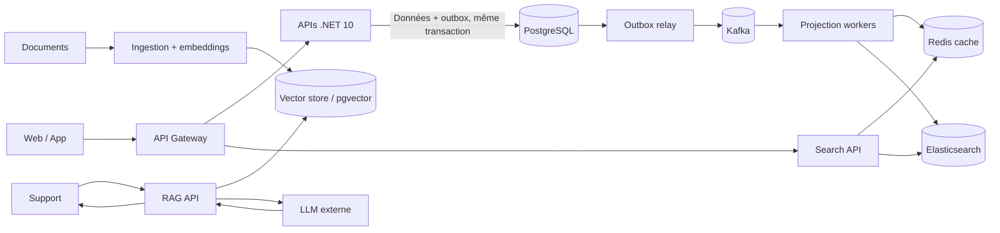

# Entretien Lead développeur — NovaMarket

**Durée : 50–60 min.** Poser environ six questions centrales et choisir une question de réserve si le temps le permet. Le candidat ne doit connaître aucun dépôt interne.

## Le système fictif

NovaMarket est une boutique en ligne. PostgreSQL est la source de vérité ; l’outbox est écrite dans la même transaction métier. Redis accélère les lectures, Elasticsearch sert la recherche. Le parcours RAG est isolé du parcours commande.

**Carte d’incident fictive** (chiffres d’exercice, pas des données réelles) : campagne x8 prévue ; en test, le p99 passe de 250 ms à 2,4 s, le taux 5xx atteint 4 %, l’attente du pool PostgreSQL dépasse 800 ms et l’âge du message Kafka atteint 3 min.

## Questions centrales

| # | Scénario | Question principale | Relances |
|---|---|---|---|
| 1 | Capacité / SLO | Comment définiriez-vous les SLI/SLO de l’API, de la recherche et des projections Kafka pour cette campagne ? Comment transformeriez-vous les signaux fictifs en décision opérationnelle ? | Quelles fenêtres et quels percentiles ? Quels seuils déclenchent protection, pause de déploiement ou communication produit ? |
| 2 | Incident en cours | Le p99 et les 5xx montent, le pool PostgreSQL attend et l’âge Kafka progresse. Décrivez votre conduite des 15 premières minutes, puis le rétablissement. | Comment répartir diagnostic, mitigation, communication et ownership ? Quelles données faut-il préserver pour le post-mortem et les actions de suivi ? |
| 3 | Kafka / cohérence | Un effet métier est validé mais le consommateur échoue avant l’offset ; le rejeu crée un doublon ou retarde une projection. Quelles garanties annoncez-vous et comment répartissez-vous les responsabilités ? | Comment traitez-vous ordre, retry, message poison, reprise et mesure du lag ? Quelles preuves de test demandez-vous avant le replay ? |
| 4 | Dégradation des lectures | Redis devient lent et Elasticsearch est en retard, alors que PostgreSQL est à jour. Quelle expérience produit définissez-vous selon les données et le parcours ? | Où accepter une donnée stale, où refuser, et comment l’indiquer ? Comment vérifiez-vous convergence, suppression et retour à la normale ? |
| 5 | Test / release / rollback | Quel plan de charge et de panne validerait la campagne et une release qui change les projections ? | Comment séparer test unitaire, intégration, soak, pic et panne injectée ? Quels seuils, canari et critères d’arrêt/rollback rendent la décision vérifiable ? |
| 6 | Résilience .NET / bibliothèques | Plusieurs API et workers partagent une bibliothèque C# de clients et de retry. Comment éviter qu’un changement de timeout/retry ou de cancellation transforme une panne aval en tempête de requêtes ? | Comment versionner et déployer progressivement ? Quels tests de compatibilité, télémétrie et owners sont requis ? |

## Questions de réserve — architecture IA et harness

| # | Scénario | Question principale | Relances |
|---|---|---|---|
| 7 | RAG | Le support doit répondre avec des sources à partir de procédures qui changent chaque semaine. À quoi le RAG sert-il ici, et quand le choisirais-tu plutôt qu’une recherche classique ou du fine-tuning ? | Quel risque prioriserais-tu en production : fraîcheur, droits d’accès, qualité du retrieval ou coût ? |
| 8 | Harness d’agent | Un assistant doit lire le statut d’une commande et, après validation humaine, demander un remboursement via un outil. À quoi sert un harness dans ce flux, et quelle partie de l’exécution lui confierais-tu ? | Quel piège de reprise traiterais-tu en priorité si l’appel d’outil expire avec un résultat incertain ? |

Tout le contexte nécessaire à l’entretien est fourni dans cette fiche.
